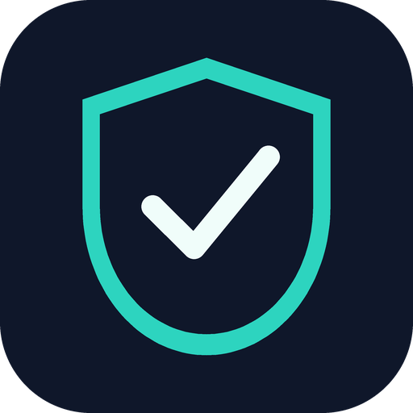
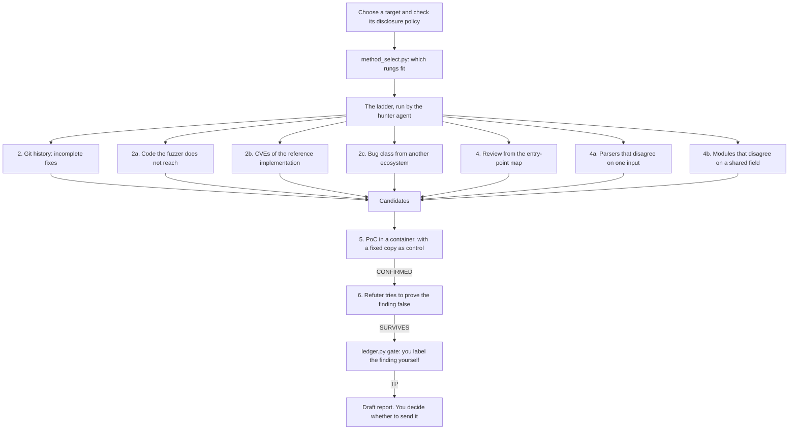

<p align="center">
  
</p>

<h1 align="center">cyber-defense</h1>

<p align="center">
  Defensive security work for <a href="https://claude.ai/code">Claude Code</a>, with proof by a run and a human gate before any report.
</p>

<p align="center">
  <a href="https://github.com/Socialpranker/cyber-defense-plugin/actions/workflows/ci.yml"></a>
  <a href="LICENSE"></a>
  <a href=".claude-plugin/plugin.json"></a>
  <a href="#status"></a>
</p>

This is a Claude Code plugin for defensive security work: incident response, malware triage, detection rules, CVE triage, and vulnerability research in open source with private disclosure to the maintainer.

The plugin is a skill (a set of instructions Claude loads when a task matches), four subagents and a folder of scripts. The skill decides three things before any work starts: whether the target is one you may touch (a request such as "may I scan this host?" is answered from your list of allowed hosts), whether the task fits what your access allows, and which mode applies. It then runs that mode and writes a report that says what was checked and what was not.

The method is not calibrated yet, and the [Status](#status) section gives the numbers. Read it before you trust a finding.

## What it does

The skill has seven modes. Each one starts from a plain request.

| Mode | A request that starts it | What you get |
|---|---|---|
| Incident | "Were we hacked?" | A timeline built from logs and artifacts, with evidence preserved before anything is cleaned up. |
| Suspicious file | "What does this file do?" | Static analysis only: the sample is never run on your machine. The result lists what the file does, its indicators and a YARA rule. |
| Detection rules | "Write a YARA rule for this" | A YARA, Sigma or semgrep rule tested against a sample that must match and three or more clean files that must not. |
| CVE triage | "Does this CVE affect us?" | A check of the installed version and of whether the vulnerable code path is reachable in your project. |
| Access terms | "Am I within the terms?" | Every requirement of your provider's usage policy, answered with yes, no or "cannot verify from here". |
| Bug bounty and open source | "Look for vulnerabilities in this repository" | The pipeline described below, ending in a draft report you decide whether to send. |
| Your own projects | "Check all my projects for leaked keys" | One pass over every repository in a folder for secrets and vulnerable dependencies. |

Two rules apply in every mode. The first is the proof rule: a finding counts as confirmed only after a run. The proof of concept (PoC, a small program that triggers the bug) must call the project's real code, must check the result at the point where the damage happens, and must have a control group. The control group is the same run against a fixed copy of the code, which has to stay silent. For a new bug with no fix yet, the fixed copy is the code with a minimal proposed patch. If both copies behave the same, the error is in the PoC. The second rule is that the skill names every step it skipped, because silence about an unchecked area reads as "checked and clean".

## What it does not do

The plugin does not test live systems that belong to someone else. Before an active check of a host that is missing from your list of allowed hosts, the skill asks you whether the host is yours or you hold the owner's written permission, and without a "yes" it runs only passive lookups such as DNS. It never edits that list. It sends nothing to a maintainer without your explicit "send it": the pipeline ends in a draft, and `ledger.py gate` keeps the draft step closed until the finding's row in the ledger carries your label.

These limits are instructions the model follows, and the scripts enforce only part of them. The gate script checks that the label is in the ledger file, but it cannot tell who wrote it. The host check is done by the model reading the list. Treat both as discipline that you supervise, the way you would supervise a junior colleague.

It does not replace a full audit of your own service. For that, use [fynd-dyrka](https://github.com/Socialpranker/fynd-dyrka-plugin), the recommended companion plugin, which runs scanners and a manual review over one service. cyber-defense works without it.

It does not get around a model refusal. When the model declines a task as a cyber risk, the skill rewrites the request once in defensive terms, and if the model declines again it stops and tells you the task is probably outside your access.

## Installation

In an interactive `claude` session:

```
/plugin marketplace add Socialpranker/cyber-defense-plugin
/plugin install cyber-defense@cyber-defense-plugin
```

To install from a local clone, pass the path to the clone to `/plugin marketplace add` instead.

The scripts need Python 3 and use only the standard library. Docker is needed for the steps that run foreign code: `sandbox_run.sh` starts a container with the sources mounted read-only, as the user `nobody`, and mounts only folders inside `CYBER_DEFENSE_HOME` or the temp dir, never either of the two as a whole. The container has no network, with one exception: the dependency-install step passes `--net`, and that step runs the project's own build scripts with internet access. Without Docker these steps are reported as blocked.

Some steps call other tools when they are installed: `gitleaks` and `osv-scanner` for the sweep of your own projects, `semgrep` for code rules, and GNU `timeout` (on macOS it comes with `brew install coreutils`) for the Docker health check.

Two settings are yours to make:

- `CYBER_DEFENSE_HOME` is the folder where the plugin keeps its working data: clones of the repositories under study, the findings ledger and the engagement journals. The default is `~/cyber-defense`.
- `~/.claude/security/scope.txt` is the list of hosts you are allowed to probe, one per line. You write it by hand. The skill reads it and asks you before any active check of a host that is missing from it. Local addresses and private networks need no entry. A list inside a project folder does not count, because an agent could have written it.

## The open source pipeline

The longest mode looks for vulnerabilities in an open source repository. It is built as a ladder of methods, ordered so that cheap steps with a known hit rate run before expensive ones. `method_select.py` reads the repository and prints which rungs fit it.



Four subagents do the work, each in its own context, so that none of them inherits the others' conclusions:

- `oss-hunter` walks the ladder on one copy of the repository and returns findings with the status of each PoC.
- `oss-cartographer` maps how different modules read the same field of shared state (a request, a session) and lists the places where they disagree.
- `oss-poc-writer` writes and runs the PoC for one candidate on the vulnerable copy and on the fixed one.
- `oss-refuter` receives a finding without the hunter's opinion of it and tries to prove it false: a check higher up the call stack, an unreachable path, a configuration nobody uses.

Before a draft the skill reads the project's `AGENTS.md`, `AI_POLICY.md` and `CONTRIBUTING` file. If the project bans AI-assisted findings altogether, the skill stops. If it bans only AI-written text, the skill drafts nothing: it hands you the facts and the PoC, and you verify the finding and write the report yourself.

## Scripts

All scripts live in `skills/cyber-defense/scripts/`. The full table with arguments is in [references/scripts.md](skills/cyber-defense/references/scripts.md).

| Script | What it does |
|---|---|
| `method_select.py` | Reads a clone and prints which ladder rungs fit it and in what order. |
| `fix_history.py` | Finds functions that were fixed two or more times and sibling call sites that did not get the fix. |
| `osv_check.py` | Looks up known vulnerabilities, fixed versions and fix commits in the OSV database. |
| `sister_cves.py` | Turns the CVEs of a reference implementation into a checklist for an alternative one. |
| `introspector.py` | Shows which code of an OSS-Fuzz project its fuzzers never reach. |
| `diff_harness.py` | Feeds one input to several parsers of the same format (URLs, paths, hosts, headers, ZIP archives) and reports where they disagree. |
| `sandbox_run.sh` | Runs foreign code in a container with read-only sources and, unless `--net` is passed, no network. |
| `replay_prep.sh` | Checks out a repository at the last release before a known fix, for blind tests of the method. |
| `cargo_lock_at.py` | Rolls `Cargo.lock` back to the crate versions that existed on a given date. |
| `estate_sweep.py` | Checks every repository in a folder for secrets and vulnerable dependencies. |
| `engagement.py` | Keeps a journal of one engagement: target, policy, hypotheses, outcomes. |
| `ledger.py` | Keeps the findings ledger, computes precision, and gates the report draft. |
| `clang-asan.Dockerfile` | Builds an image with sanitizers and libFuzzer for C and C++ targets. |

## Status

Version 0.1.0 is an early release, and the method has not passed its own calibration. Calibration here means two measurements: whether the method finds a known vulnerability without being told where it is, and what share of its findings turn out to be real.

The numbers as of November 2026:

- On live targets, 8 findings had a confirmed PoC, and 3 of those 8 were accepted as real. A PoC that runs is therefore not enough, which is why the refuter and your own review come after it.
- Method calibration is not passed. The plugin's own rules require 30 findings with two independent labels, one from the refuter agent or a known outcome and one from you, before a precision number may be quoted, and that count has not been reached.
- Rung 4a in its mode for binary formats found the known bug blind in 0 of 1 attempts.
- Rung 2c has not passed its control.
- Agents solved the four synthetic test cases in 8 runs of 8. These cases are simple, under 100 lines each, so the result shows that the agents and the harness work. It says nothing about precision on real code.

In practice this means every finding needs your own review before it goes anywhere. A false report costs a maintainer time and costs you credibility.

This repository carries two of the four synthetic cases, `lib-a` and `lib-d`, as a smoke test. The other cases are not published, because answers in a public repository end up in model training data and stop measuring anything.

## Responsible use

Use the plugin on two kinds of targets only. The first is code and systems you own or are authorized in writing to assess. The second is open source code that you study on your own machine, with any finding reported privately to the maintainer through the channel their security policy names.

Do not publish a finding, a PoC or a description of the bug before the maintainer has shipped a fix or the disclosure period they set has passed. Do not run a PoC against a deployment you do not own, even to "confirm impact".

Check what your own access and your provider's usage policy allow before you start. Some of this work, such as writing a working exploit, may be restricted on your account, and the plugin cannot grant permissions you do not have.

To report a vulnerability in the plugin itself, see [SECURITY.md](SECURITY.md).

## License

[MIT](LICENSE)
